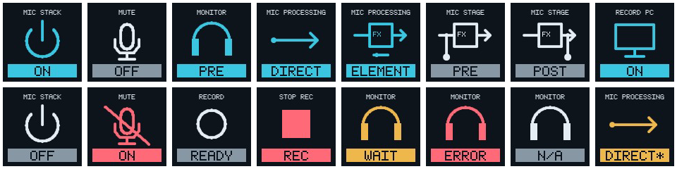
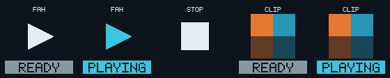
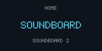
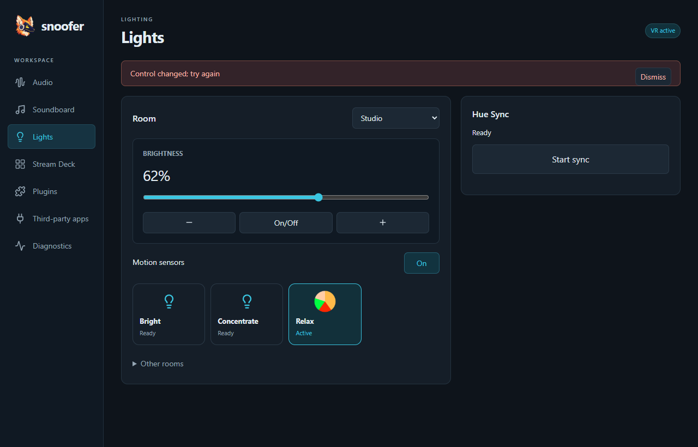
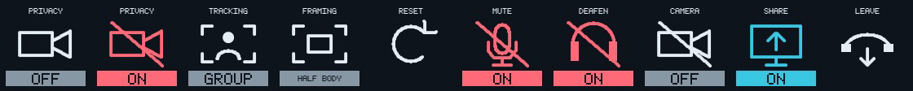
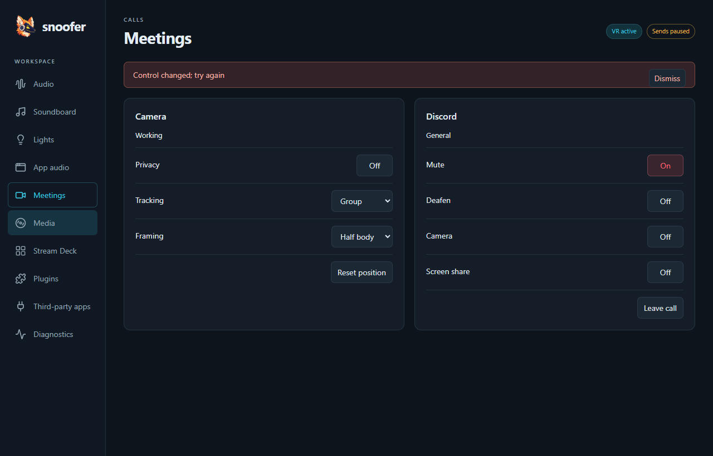
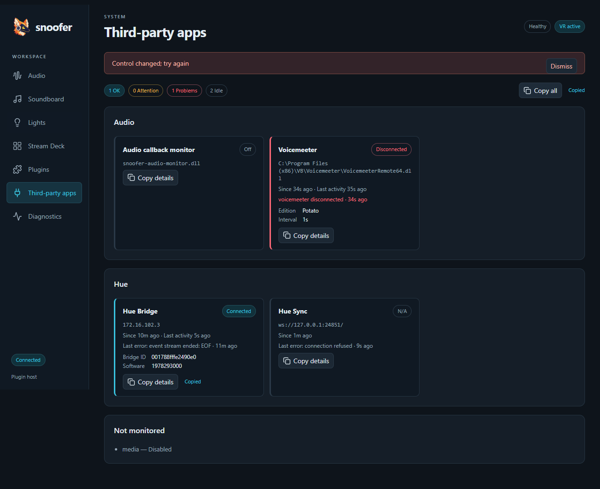

# UI contract

This is the baseline for every build, not a redesign prompt. Change it only when a requested UX change requires it. Preserve everything outside that change.

## Branding
Use the existing Snoofer mascot from app/tray.ico (source artwork in docs/assets). Do not invent a replacement logo or monogram for a new surface. Preserve the existing centered painterly mascot at the top of README.md when rewriting documentation.

## Goals and tone
Fast recognition, truthful state, predictable actions. Users know Snoofer. Use short nouns and state words, title case for built-in labels (control and option names, headings, buttons, fields: "Record Mic", "Apps on the Deck"; minor words such as a, the, and, of, on, to stay lower case unless first; acronyms keep their case), sentence case for notes and errors, content names as written, no tutorial copy, enthusiasm, redundant qualifiers or implementation terminology. Keep consequential warnings (restart/recording interruption) and actionable error details.

## Content by surface
| Surface | Content |
| --- | --- |
| Deck key | Short label, recognizable icon, current state or local status. One or two words where possible; max 16 ASCII characters for built-ins. No explanatory sentences, action IDs or profile suffix on active-profile controls. Rows, flush left: label (Archivo Bold, up to two lines, wraps then shrinks 16→12 px), 30 px icon, value (Archivo Condensed ExtraBold 30→22 px, or two lines in place of the icon for several words); nothing shares a line. Text that still cannot fit scrolls in its box as a continuous loop (the text, a gap, the text again) instead of being cut; the media dial's title scrolls too. Artwork is drawn by content type: album covers fill a cropped top band with label and value rows beneath; scene pies show wedges cropped inside the circle; soundboard clip art is shown whole, centred over the key fill; program icons and placeholders sit icon-sized above a one-line title (scrolling when long) and the volume (icon-sized on the focused-app dial too). Scene and cover artwork is up to 128 px; clips and program icons are 64 px. Scene and clip keys omit Ready, Active and Playing (fill shows Playing and Active) but keep Loop, Wait, Error and N/A. An artwork key without a value bottom-aligns its label and lets the artwork fill the space above. Text and icons stay 8 px inside the edge because keycaps round the corners. |
| Deck dial | Target in its area colour, large condensed value (a pending dial shows Wait in amber with the dashed amber bar along its top edge, like a pending key), position track (gain over -60..+12 dB with a 0 dB mark, or a percentage), full-width meter along the bottom; page dial shows `← PREVIOUS`, the current page large and light, and `NEXT →`. Press still returns Home. No repeated gain label when dB is visible. |
| GUI | Task-oriented Audio, Routing, Soundboard, Lights, App audio, Meetings, Media, Stream Deck, Plugins, Third-party apps and Diagnostics screens. Plugins only enables, disables and retries; no settings or plugin controls appear there. Diagnostics starts with a Startup card: Start at Login (On / Off), showing the Windows sign-in registration as observed, with a note when Windows disabled it or another copy holds it, and unavailable in preview. Native controls, keyboard focus, spatial deck editor and persistent local feedback. |
| Tray | Open controls, lifecycle actions, concise state. No tutorials. |

Provider Label identifies an action without an icon. Optional ShortLabel is for compact icon-bearing surfaces. Shortening presentation must never change IDs, layout bindings, command semantics or saved settings. Fixed-profile bindings retain Normal/VR qualifiers. Custom plugin labels remain intact. GUI plugin headings, Not monitored entries and binding context use registered plugin names, with plugin IDs as fallback. Binding search also accepts plugin IDs; selections retain raw control IDs. Normal/VR Microphone, Processing, Monitor and Playback labels distinguish fixed profiles. Page selectors retain provider-supplied built-in and custom names.

## Vocabulary
| Meaning | Deck label/state |
| --- | --- |
| Mic mute / speaker mute | Mute (different mic/speaker icons) |
| Monitoring | Monitor; Off / Pre / Post |
| Processing | Mic Path; Direct / Element |
| Stack enablement | Mic Stack; On / Off |
| Mic stack Off on the deck | Mic Mute, Mic Target, Mic Path, Monitor, Mic gain, Record Mic and Mic Stage keys/dials stay in place, inactive: greyed (label and icon in the unknown grey, no value or meter) and inert. Mic Stack stays normal. The GUI keeps showing them. |
| Input selection | Mic Target; Auto / selected device |
| Recording capture | Record Mic / Record PC; On / Off |
| Recording tap | Mic Stage; Pre / Post |
| Recorder transport | Tape-deck style: Record starts (stopping playback first) or stops a recording (Record / Stop Rec; Ready / Rec); Play/Pause plays, pauses the tape with one stop, or pauses and resumes a recording; Stop returns the tape to the start (a second stop) or ends a recording |
| Tape playback | Play (Ready / Playing with pause bars / Paused; Rec with pause bars while recording, Paused while a recording is paused), Stop, Rew, FF; plays the recorder's loaded file to the Playback destination; Stop, Rew and FF show Ready when applicable; a key with nothing to do (Stop when idle, Rew and FF while recording) is greyed out and inert, and the GUI disables it; every transport key is N/A only while the recorder state is unknown |
| Media transport | Prev / Play / Next / Stop; no fictitious playback state |
| Track rating | Like / Dislike; distinct thumb-up/down symbols, On / Off from observed rating. The selected rating uses Media fill; unknown is N/A, pending is Wait and failure uses the existing error frame. |
| Soundboard | Filename / Stop; Ready / Playing (cyan) / Loop (cyan, shown on the key), Wait during normalization; failures stay local to the clip. Tap plays once (deck: on release); hold 500 ms loops until Stop |
| Gain | Playback / Mic; numeric dB, position track and meter; while Element is the effective processing, the Mic meter shows the processed return (AUX) |
| Soundboard gain | Volume; numeric dB; press resets to 0 dB |
| Soundboard overlap | Overlap; On / Off (stacked play symbol). On: up to 8 clips play together, the oldest is cut; Stop silences all |
| Hue scene | Scene name; Ready / Active (cyan); Wait until the bridge confirms |
| Hue room dial | Brightness: percent or Off, press toggles on/off; no color-temperature control |
| Hue scene sort | Sort; Name / Hue / Brightness; a press cycles them |
| Hue pairing | Pair; Ready / Press button / Paired |
| Hue Sync | Sync; On (cyan) / Off. Sync bright: percent, press toggles sync. Mode / Intensity: app value |
| Pending | Wait |
| Unavailable or unknown | N/A; meter LEVEL N/A |
| Failed | Error; detailed diagnostic in GUI |
| Overridden normal profile | VR; GUI VR override |
| Output destination | Slot name with speaker symbol; In use (cyan) / No device / Disconnected / No output (amber) |
| Route switch | Computer / Monitor / Soundboard / Tape; On / Off |

Status takes priority only on the affected control. Keep uncertainty distinct from Off or zero. Meter expiry must not show silence. Ready is not recording; enabled capture is not recorder transport.

## Color semantics
Colors supplement shape and words; they never carry state alone. No perimeter borders except the rounded red error frame. On the deck, the icon names an area and the area colour is identity: an off key is dark with its label and icon in the area colour, and an on key is filled with it, with dark ink. Muted and recording fill red; error is a rounded red frame with `!`; pending is amber dashes with an amber value; fallback fills amber; unknown is a grey N/A. The GUI keeps the state palette below.

| Deck area | Colour | Icons |
| --- | --- | --- |
| Mic | #38C6E0 | Mic, mic stack, mode, tap, echo and call |
| Playback | #6E93FF | Speaker, VR playback, monitor, deafen |
| Recorder | #A98BFF | Record and tape transport |
| Soundboard | #5FD38A | Soundboard |
| Media and apps | #E57CF0 | Media transport, app audio |
| Lights | #EFE7D3 | Hue and Hue Sync |
| Other | #C5CBD0 | Pages, scroll, focus reset, everything else |

| Meaning | Deck color | Use |
| --- | --- | --- |
| Normal text | #E3EDF3 | Labels and neutral symbols |
| Neutral | #8797A3 | Off, Ready, generic commands |
| Active | #3AC6E1 | On/live, active processing mode, enabled monitor |
| Attention | #EEB74C | Wait, fallback, confirmation |
| Critical / audio inhibition | #FF6978 | Error, muted mic/output, recorder currently recording |
| Unavailable | #8797A3 | N/A; never danger merely because a device is absent |
| Background | #0E141B | Key and dial background |
| Meter signal | #2DD28C / #F5BE3C / #FF5A64 | -60..0 dBFS continuous gradient over a dimmed unlit track; amber from the -12 dB region, red near -3 dB; held peak tick (red at -3 dB or above); not application status. The deck strip draws flat green, amber and red zones instead of the gradient |

Precedence: unavailable > failure > pending/fallback > muted/recording > active > neutral. Ordinary Off is neutral, including disabled mic stack. Recording's circle/square and Ready/Rec distinguish transport state. Deck categories use only the area colours above; no arbitrary colours per control. Color definitions and precedence live in internal/streamdeck/palette.go.

The GUI replaces the terminal renderer. Use the available workspace responsively: a vertical sidebar (Up/Down), content cards, and a spatial deck grid with a contextual inspector. Tab follows standard focus order; arrows on the deck follow its geometry. Never dispatch a binding merely by selecting its position. Keep text edits, search and focus stable during live updates. Surface-only audio transport actions stay off the Audio page; they remain available as deck bindings. The exception is the Recording card's recorder row: Record, Play/Pause, Stop, Rewind and Fast-forward (the last two as icon buttons).

GUI icons are Lucide line icons (vendored; nav, buttons, placeholders, deck previews), never Unicode glyphs; Stream Deck hardware keys keep their code-drawn icons. GUI styling is Tailwind utilities with palette tokens in app/web/tailwind.css; no hand-written component classes. The sidebar has no host-connection footer. Failed host polling shows a global Reconnecting to Snoofer banner below the shared header, separate from action errors. Keep the last screen readable and navigation available. Refuse new actions with an explicit not-sent message; never replay them after recovery. Polling backs off to at most five seconds and returns to its normal cadence after a successful response. Recovery clears the connection banner without dismissing unresolved action errors. The shared header shows only transient badges (Sending, VR active, and Devices paused / Sends paused while Disable device or send manipulation is on); audio health appears as the Engine row on the Audio screen and on Diagnostics, never in the header. Apply the shared state palette to the GUI, with a separate visible focus outline. Normal sections are subdued but editable during VR override. Keep important errors local and visible; Diagnostics holds full details. Explicit Save/Discard applies only to draft deck configuration; regular audio controls remain live. Use the existing logo, not a new mark. The sidebar keeps the mascot and complete wordmark inside its usable content width, including space reserved for a native scrollbar. Minimum window is 800×600; do not cap the workspace to terminal dimensions.

Live configuration dropdowns keep native select controls. With the popup closed, arrows, Home/End, PageUp/PageDown and typeahead browse a local choice; Enter commits once, while Escape or leaving the field, including Tab, restores the observed choice. Inside an open native popup, a pointer choice, Enter or Tab confirms once; Escape, Alt+Up and clicking outside cancel. Re-selecting the same choice sends nothing. Semantic selections retain their focus-time revision, and Routing edits keep their existing stale-list checks. Stream Deck draft/navigation selects and forms with Add/Apply keep their separate commitment rules.

## Visual and behavioral invariants
- Studio line icons, dark background, label above symbol, state badge below; no key outline.
- Signal path is left-to-right. Direct bypasses FX; Element passes through FX. Pre/Post taps branch before/after FX.
- Mic stack is power, mute is a mic with a slash when muted.
- Keep native rotation, blank unused keys, user-owned pages, dial pagination and meter placement.
- Do not change bindings, page positions, shortcuts, profile ownership, save/apply behavior or confirmations as a side effect of copy/style work.
- A UI change must update this contract when needed, add/update focused presentation checks, and inspect actual native-size renderer output. No fresh visual direction or synonyms on routine builds.

## Visual baseline

Top: normal labels and signal-path states. Bottom: stack Off, muted, recorder Ready/Rec, Wait, Error, N/A, and fallback. The last example shows the amber fallback accent and * suffix. A supplied fallback never relies on color alone.

## Deck pages
While Windows is locked or the monitors are off, the deck is dark (black keys and touch strip, backlight off where supported) and inert: no key, dial or touch acts until the session is unlocked with the monitors on, which restores the current page at the configured brightness (`brightness`, 1-100, default 100). An unknown lock state leaves the deck lit. The Stream Deck connection report shows Display: On, Dark (locked) or Dark (displays off).

Pages are organized by task: Home holds live essentials; content pages (Soundboard, Lights) hold browsing. Fixed controls sit on an edge row or column; generated content fills regions; overflow sets repeat the fixed frame, and Up/Down scroll keys page through them. A control keeps its position across the pages it appears on (Playback and Mic are dials 1–2, Brightness is dial 5). Home reaches each content page in one press with go-to keys; the page dial's press returns Home, so there is no Home key. Blank means not applicable now; N/A means expected but unknown.

Every supported model (+ XL, +, XL, MK.2/Original v2, Neo) keeps this baseline: keys are drawn on the 112 px design canvas and resampled to the model’s native size, never restyled per model. The page control is the last dial on the + XL and +, the reserved bottom-right Pages key on the XL and MK.2 (current page name with the page icon; press next, hold Home), and the touch buttons with the page name on the Neo screen. Model defaults keep Playback and Mic on dials 1–2 and the + XL frame scaled to the grid. The GUI deck editor draws the selected model’s grid; the reserved Pages key or dial shows as Reserved. Device lists model layouts and decks with Own Layout; Forget and turning Own Layout off need confirmation. Paging is Independent or Mirrored.

App audio (the `appaudio` plugin) gives each app a dial and a mirroring key on the Apps page: turn for volume, press to mute. Keys show the app icon, name and `42%`, `Muted` (critical) or `Mixed`, and Pending until Windows reports the change; `Ignored by app` marks programs that reset their own volume. Picked apps come first, then apps heard within a configurable window (5 minutes by default, set on the App audio screen). The App audio screen offers a strip per app with pin, order, Rename, Combine into… and Hide, and a Named here list of its rename and combined programs with Separate to undo one; an Excluded card of program file names (wildcards allowed; Snoofer, Voicemeeter, audiodg and Hue Sync by default) with Add and Remove, showing which running apps each hides; and per-app details (executables, PIDs, devices, rule). Dial regions fill dials from a collection and page in step with key regions.

Apps and sessions without a logo show a placeholder tile in a colour derived from their name (the same colour every time), with a window or play glyph. Now playing lists every media session: Windows players, and each browser tab while the Snoofer extension is connected, which replaces that browser's single Windows entry. Session keys show cover art and Playing/Paused; a press plays or pauses that session and focuses it. Focus is sticky: a chosen session or app keeps its dial until Reset focus; otherwise the media dial follows the latest playback and the focused-app dial the first app. On session and app keys a tap plays/pauses or mutes and a hold chooses focus. There is no Focus key. Transport keys sit on the Media page's bottom row. Apps share the Media page: the Media page's dials are Playback, media, the focused app, then apps (never the same app twice), Home's row 1 is the mic path ending with Echo and Echo strength; row 2 is recording, left to right: Record mic, Record PC, Mic stage, Record, Play, Stop, Rew, FF. Home's bottom row is Previous, Play/Pause, Next, Brightness, Motion and the go-to keys, with session and app strips on row 3 (clipped: no extra Home pages; tap plays/pauses or mutes, hold chooses focus) and Reset focus at r3c9, which returns both focus dials to their defaults; Home's dial 4 is the focused-app dial; Home's transport keys act on the focused session, with an Apps filter (All, Pinned, Off) and a Media filter (On, Off) on the bottom row; filters affect the deck only. Sessions and apps share rows 1–3 by need, so a filtered category's space goes to the other, and a hidden binding's key or dial is reused by a covering region. The media dial shows art, title and `m:ss / m:ss` with a progress track; turning seeks 5 s per detent, and a press plays or pauses. Previous, Play/Pause, Next and Mute (tabs only) act on the focused session and are blank when it cannot do that. The Media screen shows session cards and a Browser extension card with connection status and install steps; the Snoofer Media extension needs no setup or pairing.

Echo cancellation (the `aec` plugin) removes speaker echo from the managed microphone. Its mode is Auto (active while playback goes to speakers), On or Off, and Strength is Strong, Balanced or Gentle. Status is Active with echo removed (dB) and the estimated delay, Idle with the reason (Headphones, Mic off, Needs 48 kHz and similar), Wait, Off or Error (the mic passes through). The Audio screen has an Echo cancellation card, and the Echo key (speaker, struck-out sound, mic) cycles Auto, On and Off; On is cyan.

Output-slot device names are descriptive detail on the GUI; destination keys retain their state word (In use, No device, Disconnected or No output) and its state color.

The default Routing page puts destinations on rows (Playback, then output slots 1–3) and sources on columns (destination, Computer, Monitor, Soundboard, Tape); positions without a slot or source are blank keys with their bindings kept. Default Home reaches it from r1c9. Playback and Mic remain dials 1–2.

Status controls can be bound to keys for display only: taps and holds do nothing while provider state continues to update. They are excluded from dial bindings; text controls are excluded from both keys and dials. The editor and layout validation use the same compatibility rules, and missing providers retain their saved bindings.

Regions are rectangles filled from a named collection (Soundboard clips, Scenes · selected room, Scenes · <room>) in label order, skipping Hidden members. Manual and shared bindings win, and overflow adds `Name N` pages. A legacy `auto_controls` prefix acts as a whole-page region. Go-to keys use the folder symbol with the page name and show Here on that page. Scroll keys (Up, Down) use arrow symbols, show the set position (`1/2`), wrap, and are blank when the page has one set; a page that binds one is a single stop on the page dial. The editor numbers keys from 1 everywhere, selects rectangles with Shift+click or Shift+arrows, and tints region cells. Selecting never dispatches. Each region row has an Overflow checkbox (off saves the region clipped: it shows only what fits and adds no sets, even when several sources share its rows) and names sources sharing its rows as `+ App audio`. New regions overflow. With more than one set, the Regions panel says `3 sets · Up/Down`, or `3 sets · page dial visits each` in attention colour when the page has no scroll key. Make Home is disabled on Home.

## Soundboard pages
Clips fill a region; manual and shared bindings win. File names become title-case labels (underscores and hyphens read as spaces; acronyms keep their case); Play/Stop symbols identify transport. Matching PNG/JPEG/WebP/GIF artwork fits proportionally within a square and may replace the clip symbol in a 64px area, preserving its filename and state badge. Artwork colors are user content; badges retain semantic colors. Animated GIF artwork plays on keys and on the Soundboard screen; its first frame is the static artwork elsewhere, and GIFs over 120 frames stay static with a note. Invalid/missing artwork falls back to Play. Overlap, Up, Down and Stop hold column 9 on every generated set. While clips play, the touch-strip panels above unbound dials on pages with soundboard controls show each clip's artwork (or Play) and remaining time as `m:ss`, oldest first: one per panel, two per panel when more play. The configurator edits the saved template and previews automatic bindings; removing the region disables automatic filling.

Soundboard key reference (Ready, Playing, Stop, and sample artwork in Ready/Playing):

Page dial reference:

## Hue
Scene keys show generated artwork: a disc of wedges in the scene's dominant colors (sized by light count, in full colour); on scene keys a small sun badge at the artwork's top right shows the scene's overall brightness by its rays: none under 15%, then 2, 4, 6 and 8 rays up to full, on keys and Lights cards. It replaces only the central symbol; scenes without color data keep the bulb symbol. Artwork colors are scene content, while badges keep semantic colors. Scene keys work with `auto_controls` prefixes (`hue.scene-` or `hue.scene-<room>-`). Decor, Mixed and Saturation dials act on the selected room's decorative lights, mixed lights and colour lights: turning stages a target (shown as `→ 60%`; nothing is sent), a press on any of them applies every staged target at once, a press with nothing staged toggles Decor or Mixed, and stages are dropped together 10 s after the last turn. While a press is being applied and confirmed the dial shows Wait, like a pending key. They are blank when the room has no such lights, Saturation shows White when no colour light shows a colour, and all three are unavailable while Hue Sync streams. Saturation uses a drop symbol; Decor and Mixed use the sun. Brightness is a dial control without a meter: the strip shows target and value only, and while a write is pending it shows the requested value (GUI marks it pending) rather than Wait. A control's Icon is an identifier and never appears as dial text; only the page dial uses that field for page names. Hue Sync uses the screen-with-rays symbol; mode and intensity show the app's value. While syncing, Brightness shows `Sync 62%` and adjusts the sync stream. Room scene slots (`hue.room-scene-1`…`12`) mirror the selected room's scenes by name; an unused slot (unavailable, no label or icon) is a blank key, never N/A. A Hidden control is also a blank key with its binding kept: Mode and Intensity while not syncing, and Sync while the Hue Sync app is not connected. Motion toggles the selected room's motion sensors (the bridge's per-sensor enable): On, Off or Mixed, Pending until the bridge reports the change; it is blank when the room has no sensors. Snoofer controls only the rooms chosen on the Lights screen, in the GUI and on the deck. The Room key cycles the chosen rooms by name and is blank while only one is chosen; scene regions and Motion follow it. Selection keys always show option labels, never raw values.

Lights screen: setup banner only while something needs doing (Enable, Pair with the found bridge, link-button instruction, errors). Room card with the room picker in its header, a Brightness (On/Off) readout with slider and −/+, a Motion sensors row (only while the room has sensors), a segmented Sort (Name, Hue, Brightness), the room's scene cards and Other rooms (chosen rooms only), all in the chosen sort. A Rooms card lists every room and zone with a checkbox; the last chosen one cannot be unchecked. Hue Sync card with Start/Stop sync, segmented Mode and Intensity (disabled with a reason while not syncing) and the Third-party control instruction when unreachable.

## Meetings
Meetings exposes one shared Mute and Camera target for all compatible joined calls.
Mute On means the shared muted intent; Camera On means the shared camera-on intent.
Use the existing mic/camera symbols and terse labels. Target values remain visible
while Pending or Not confirmed; target acceptance is distinct from all apps having
observed that state. Unknown is N/A, never Off. Camera is unavailable without a
known eligible call state and is discarded when the last compatible call ends.

Discord and Google Meet cards retain independent lifecycle gates and show actual
per-app state. One provider being Off, Starting or failed never hides the other or
the shared controls. The Meet Call selector is for its observed details; it does
not limit universal synchronization to one tab. Call choices use browser and tab
number without meeting names or codes. Source muted/Mic Stack off remains distinct
from app-local state. Third-party Apps owns connection diagnostics; Plugins owns
lifecycle actions.

Changing mute/camera in a compatible app updates shared intent and the other apps.
Snoofer's saved Mic Mute remains the durable mute authority when audio is available;
audio-absent operation uses runtime mute intent. Discord deafening retains its
existing synthetic-mute exception. Share, Leave and Deafen act on the focused joined call. Focus buttons default to
the newest observed call; an explicit choice stays pinned until that call ends.
Mute and Camera remain universal. Deafen is N/A for Meet or no supported call.
Share opens the native presentation workflow; choosing a source remains the user's action. A menu opening is not sharing On. Explicit per-app bindings remain local.
Discord setup/Connect affordances remain unchanged.

Existing saved Discord/Meet mute and camera bindings request shared intent. The
user's Plus XL Meetings Mute/Camera positions remain, now targeting shared controls;
Leave stays apart at c9. Do not change shipped defaults or smaller deck layouts.

Historical Discord-only renderer references (the current shared surface is verified
by automated layouts and native previews):

## Third-party apps
One card per connection report, grouped by plugin: app name, state badge, endpoint (monospace), "Since" and "Last activity" as relative times (amber "stale" when activity is older than three report intervals), the last error with its age (critical while it is the current state; muted "Last error:" after recovery), details and Copy details. A summary shows OK / Attention / Problems / Idle counts and Copy all. Tone: connected and ready are active; connecting and attention are attention; error, and disconnected when the peer is required, are critical; disconnected optional peers and off, unconfigured and unknown stay neutral. Plugins that are not running are listed as Not monitored. Reports are read-only and never appear on the deck. Copied text uses absolute ISO timestamps and never contains credentials.

## Personal layout
User amendment 2026-10-15: Plus XL Meetings keeps Mute, Deafen, Camera and Share
at r1c1–c4 and Leave at r1c9, using the shared/focused meetings controls. Call
focus buttons fill the formerly empty r2c1–c9 from meetings.focus with normal
overflow. Focus uses the handset icon, identifies its app/browser tab, and is On
only for the selected call. Smaller-deck layouts remain unchanged.

User amendment 2026-10-15: Plus XL Home Like at r1c9 and Dislike at r2c9 supersede
the older assignments listed below. These two rating bindings were applied on
2026-10-16; smaller decks remain unchanged for later redesign.

Positions are row/column (r1c1 top-left). Home: Open controls at r4c5; Sync, Mode, Intensity and Brightness (press toggles the room) at r1c6–c9; Motion at r2c9; go-to Meetings, Soundboard and Lights at r4c6, r4c8 and r4c9. Lights: Room, Brightness, Motion, Sort, Sync, Mode, Intensity at r1c1–c7, room scenes region r2–r4. Soundboard: clips region r1–r4 c1–c8, Overlap r1c9, Stop r4c9. Meetings: Mute, Deafen, Camera and Share at r1c1–c4, Leave at r1c9. Chosen rooms: Cody Office. Dials: Playback (1), Mic (2), Brightness (5) on Home; Playback (1), Saturation (2), Decor (3), Mixed (4), Brightness (5) on Lights; Playback and Mic on Meetings; 3 and 4 unassigned; dial 6 is pagination. Soundboard dial 1 is Volume. This is a user-owned layout choice; do not relocate it during builds or overwrite other users' layouts.

## Routing
The Routing screen (after Audio) starts with Outputs: a matrix of sources (Computer, Monitor, Soundboard, Tape) against destinations (Playback, then up to three named output slots). Each cell is an On/Off switch (Monitor on Playback cycles Off/Pre/Post); Playback always receives tape listen-back. Column headers show the device and, for slots, In use (active), No device or Disconnected (neutral) or No output (attention), with device choice (including No device), Rename and Remove. A slot without a device keeps its switches, so routing can be set up before the device is assigned. Add output takes a name and optionally a connected device that is neither Playback nor another slot. Below it, Microphones lists the user's microphones numbered by the input each uses, with name, source (Interface channels, Device, or a connected input to switch to), an Always ready toggle (never metered, so Auto never skips it for silence; a missing device still makes it unavailable), state (In use, Silent in attention, Ready or Unavailable), Up, Down and Remove; device microphones list their devices in priority order, and Add microphone takes a name and either interface channels or a connected input. Then device priorities: Interfaces (driver and presence, and per interface microphone Off, Mono with one channel, or Stereo with left and right channels; a new interface maps none), Playback, Mic priority and Activity (Meter Off or Top 1–4, Silence below in dBFS and Silent after in seconds; values apply on change). Microphone names come from configuration everywhere, including deck option labels. Rows are numbered in priority order with Up, Down and Remove; the last entry of a required list cannot be removed. Each entry shows its match under the planner's rules: In use (active), Ready, No match (neutral) or Ambiguous · N (attention), with matched names below. Suggestions list connected devices no entry matches. Add saves the device by identity (Windows endpoint ID or ASIO driver), so it survives Windows renaming it; Exact pattern and Partial pattern are the advanced forms. Patterns are generated by Snoofer, never by the GUI. Entries by identity show the device's current name, or their saved name with Disconnected, instead of a pattern field. Slots and interfaces are assigned by identity in the same way. Add interface pairs an installed driver with the input that proves its hardware is present. Patterns apply on Enter or Apply, never while typing. Edits are saved before they apply and take effect without a restart; a refused edit shows its error above the lists and leaves routing unchanged. The sidebar scrolls when its items exceed the window height.

## Playback and interface
Interface is the global ASIO clock/input/output selection. Playback is the active listening destination; A1/A2 belong only in diagnostics. Use one Playback dial/mixer with destination name in the GUI. Home dials start with Playback at index 0 and Mic at index 1. Dials 1–5 are assignable; only dial 6 is reserved for pagination. Gain changes only on explicit adjustment; routing never copies or resets gains. Playback mute is Snoofer-owned persisted desired state; native disagreement is pending, never a replacement preference.

Meters on dials and GUI strips share ballistics: instant attack, 24 dB/s release, 1.5 s peak hold then an 18 dB/s fall. Ballistics shape presentation only; an unknown or expired reading resets them and shows LEVEL N/A. The deck refreshes every 60 ms while a shown dial has a meter; the GUI polls every 100 ms on Audio and Soundboard.

The Echo cancellation card includes an Engine selector: WebRTC AEC3 (default), LocalVQE echo-only, and LocalVQE voice cleanup. Strength is disabled for neural engines. Neural processing is 16 kHz mono with reported processing latency (about 61 ms with 512 samples at 48 kHz); active status states this limit. Neural reference is an eight-channel downmix, so independent surround cancellation is not equivalent to AEC3. Loading shows Wait; a load/deadline failure shows Error with microphone pass-through. Engine choice is saved before switching. Deck layout and Auto/On/Off remain unchanged.

LocalVQE full-band is an optional fourth engine: the voice-cleanup neural model below a 6 kHz crossover and WebRTC AEC3 above it. It requires a 48 kHz host stream, with other rates showing Needs 48 kHz and pass-through. Status reads 48 kHz mono · hybrid plus measured processing latency (approximately 63 ms at 512 samples). Existing neural modes and preferences stay unchanged; the upper band has echo control but does not receive the neural noise cleanup.

Playback source sends appear in Routing and retain their existing deck bindings; the Audio Routing & Recovery card contains recovery and manipulation controls.

Echo cancellation has a Retry button, enabled for engine or load failures while processing is wanted, disabled during loading, inactivity or unconfirmed hook removal. Retry is a compact action below Timing, with no empty field caption. Retry resets only AEC and does not change saved preferences. Latched native failures retry automatically every 15 seconds; the error remains visible with automatic retry pending, and a reset shows Wait until processing is observed.

Neural Timing shows lifetime peak worker-packet / queue-wait milliseconds, including warm-up, and cumulative gap/underrun counts. These are diagnostic peaks, not measured end-to-end latency. Hybrid upper-band gain follows a smooth neural-output gate; isolated high frequencies and very quiet speech can be attenuated.

Diagnostics keeps Startup and the Engine health row with restart actions. Current Notices groups full statuses by plugin name, summarizes repeated Normal-profile VR override once, and leaves known descriptive device/echo/timing detail on its owning screen. Unrecognized warnings and failures remain visible, including unavailable controls. Copy Notices copies the displayed context and details; its local feedback survives polling. Ordinary audio settings remain on Audio.

Audio cards use their content height. Engine and Interface appear together above the live switches and gain strips, with each live switch beside its label. GUI meter scales retain -60, -30, -12 and 0; the -3 label appears only when the strip has at least 400px available, preventing crowded labels without changing signal colors or exact readings.

Automatic rebuilds of the current GUI screen preserve registered search filters, expanded sections, focus and scroll by stable target identity. Provider values continue to refresh. Removed or disabled focus targets fall back to screen content, and open dialogs keep their focus. Navigation starts a fresh screen view.

App Audio More retains unchanged detail text and selection while other values, including Heard, refresh. Within an existing card, Media keeps its play/pause icon while its displayed playback state is unchanged; metadata, accessible labels, clocks and actions continue to update.

Routing provides local section links. Output source switches and state stay in the table; Output Devices below it owns slot device/name/removal. Candidate movement stays beside each field, with match detail below. Microphone Apply appears only for a changed name; Enter applies, Escape cancels, and blur never writes.

The Deck Device/Page fields use matching stacked layouts. Save/Discard sits near them in normal document flow and never overlays the editor. Edit All Pages identifies shared binding scope with Same position on every page. A nonempty Soundboard library with no search matches shows No matching clips; clearing search restores the clips.

Unapplied Routing names, patterns and Add choices survive unrelated rebuilds with their original revision. A changed configuration drops incompatible drafts. Removed or repurposed catalogue choices require reselection; explicit No device adds only a named output.

Plugin screens use the same lifecycle panel: Not part of this build, Off with Enable, Starting, or Could not start with the full error and a Plugins recovery action. A running plugin waits for its screen's required publication; empty media, app or clip lists and an offline Deck editor remain ordinary content. Lifecycle changes replace unavailable controls immediately, even during editing. Plugins uses typed lifecycle state, offers Retry Plugins for failed starts, and never offers Enable for a plugin absent from the build. Enable, Disable and Retry retain host confirmation and restart warnings; disconnected or busy lifecycle actions cannot be submitted.

GUI actions reserve only their semantic control (including its mirrors); independent controls remain usable. Selection, Retry Plugins and host confirmation share one lifecycle reservation. Show Sending beside the affected control and a compact screen-local header badge. After 2.5 seconds without a reply show “Outcome unknown; still waiting.” and retain the reservation. Revisions, notices, confirmation text and no-change polls never acknowledge an action. Only its matching result or connection loss settles it; never replay an uncertain action.

Result labels distinguish Submitted (accepted for untracked work), Processed (the defined operation completed), Rejected (refused before work began), Failed (processing reported an error) and Unknown (the outcome cannot be established). They do not claim the desired state was observed; polling remains authoritative for state. Keep the latest result beside its originating screen/control, retain unresolved failures across navigation, and offer local Dismiss. Removed targets retain one bounded screen summary. Results never move to a different screen that happens to show the same control, and action failures do not feed sidebar attention markers.

Plugin selection uses the configuration revision displayed when its UI was drawn. A host confirmation freezes its displayed wording and proposal identity; Apply and Cancel submit that exact proposal, never a replacement received while the dialog is open. Show lifecycle errors inside an open host confirmation. Local destructive confirmations keep their own captured target tickets and remain independent of unrelated actions.

Delete Page, Forget Deck and disabling Own Layout use the shared styled confirmation while polling continues. Cancel is the default and sends nothing. Acceptance uses the captured target and revision once; changed/unavailable targets or connection loss disable acceptance until cancellation. Host confirmations take precedence. Enabling Own Layout remains direct; Delete Page still requires Save Layout to persist.

The sidebar marks a screen only for a current typed lifecycle failure, approved provider attention, Routing ambiguity or typed connection issue visible there. Critical takes precedence over attention; recovery clears the marker. Third-Party Apps owns connection diagnostics, while Plugins owns failed starts. Optional missing devices, ordinary mute/Off/Preview/pending states, dirty layouts and historical errors are neutral. The marker occupies the navigation icon's existing space, preserves the button name, adds Problem or Needs attention as its description, and creates no focus stop or action. Narrow labels may wrap inside the existing sidebar width. The header remains limited to transient activity badges and the separate connection banner.

Shared error notices keep Dismiss vertically centered within the notice padding. Complete messages, including long identifiers and line breaks, wrap beside it without overlap or horizontal scrolling. Unchanged polling retains the focused Dismiss button; dismissal remains local.

## VR Clipboard
The optional VR Clipboard plugin adds a SteamVR dashboard tile, without a new
desktop screen or changing the audio VR profile. The compact pad has large Copy,
Cut, Paste, Select All, Tab, Backspace and Enter buttons, plus Use Focused App.
The header identifies the captured target by executable name; never display
clipboard contents or window titles. Follow newly selected eligible desktop apps
while the panel is active; retain the last target while SteamVR owns focus. A
target change cancels any held gesture and redraws before accepting fresh input.
Use the existing dark background, light text, cyan pointer/press treatment and
red failure text, with a visible outline for hovered buttons. Holding never
repeats an action. Feedback says Shortcut sent, not Copied/Pasted: Windows key
insertion does not confirm application behavior. The dashboard is user-opened,
not automatically summoned. Plugins owns enablement and Third-party apps shows
connection/failure state.

VR Clipboard shows Clearing queued input during overflow recovery and returns to
ready automatically once its queues are drained. Pending button presses are
cancelled; recovery never repeats a clipboard action.
